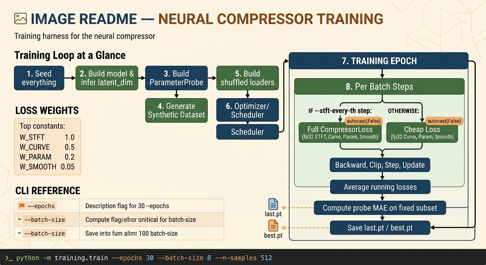

Copyright © 2026 Lewis James Seals Jr. All rights reserved.
THE SOFTWARE IS PROVIDED "AS IS", WITHOUT WARRANTY OF ANY KIND,
EXPRESS OR IMPLIED, INCLUDING BUT NOT LIMITED TO THE WARRANTIES OF
MERCHANTABILITY, FITNESS FOR A PARTICULAR PURPOSE AND
NONINFRINGEMENT.

# Neural Compressor Training



A research training harness for distilling a classical single-band compressor
into a neural model. The recovered teacher and model modules are adapted from
the owner's `expert-lamp` repository.

## Current integration contract

- Mono input audio: `(B, 1, T)`, float32.
- `build_model(n_bands=1)` returns the recovered dilated CNN.
- Forward returns `(y_pred, g_pred, g_bands, extras)`.
- `extras["latent"]` feeds `ParameterProbe(latent_dim, n_params=4)`.
- The probe predicts normalized threshold, ratio, attack, and release.
- The teacher is a classical offline target generator; it is not a
  differentiable teacher-training graph.
- The teacher gain is interpolated to sample rate and averaged on the same
  256-sample frame grid as the student gain output. Gain-curve loss rejects
  mismatched shapes; it does not truncate unrelated grids.
- The teacher is single-band. `--n-bands` accepts only `1`; multi-band
  supervision has not been defined.
- Original Neural-Compressor-Script loss weights are retained:
  STFT=1.0, curve=0.5, parameter=0.2, smoothness=0.05.

## Requirements

- Python 3.10+
- PyTorch
- NumPy

## Quick start

From the repository root:

```bash
python -m training.train --epochs 1 --n-samples 8 --n-val 4 --n-test 4 \
  --batch-size 2 --duration 0.25 --no-amp --device cpu --dry-run

python -m training.train --epochs 20 --n-samples 512 --n-val 64 --n-test 64
```

For a real training run, omit `--dry-run`. Resume only from a checkpoint
created by this integration:

```bash
python -m training.train --resume checkpoints/last.pt
```

A resume requires the saved dataset/model/loss configuration to match the
current command. Checkpoints use a versioned schema and load with
`weights_only=True`; unrestricted pickle fallback is intentionally disabled.
Legacy checkpoints require an explicit trusted offline migration.

## Data and evaluation

The synthetic dataset is deterministic for a fixed seed and configuration.
Train, validation, and test sets use distinct `(seed, sample_index)` IDs.
Best-checkpoint selection uses validation gain-curve loss. The test set is
evaluated separately after training. Reports record environment, split IDs,
model/loss configuration, validation selection metric, and test metrics.

The current synthetic signal generator and classical teacher are research
fixtures, not a substitute for rights-cleared real-world audio evaluation.

## Semantic integration

`--strict-semantic` is retained only to fail explicitly: the inspected
HarmoniaCodec-Music source does not provide
`harmonia_neural.semantic_postcheck`. Harmonia semantic components are not
silently assumed to be part of this compressor.

## Verification status

The integration branch contains source and focused tests, but those tests,
the CPU smoke run, reproducibility comparison, convergence, perceptual quality,
and neural-versus-classical performance have **not yet been executed or
established**. See [the integration audit](docs/EXPERT_LAMP_INTEGRATION.md)
for the correction and acceptance checklist.
